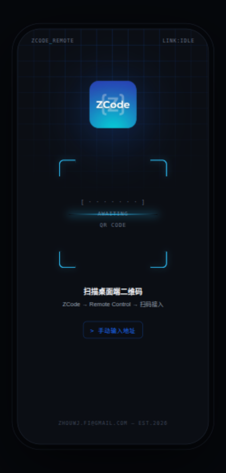
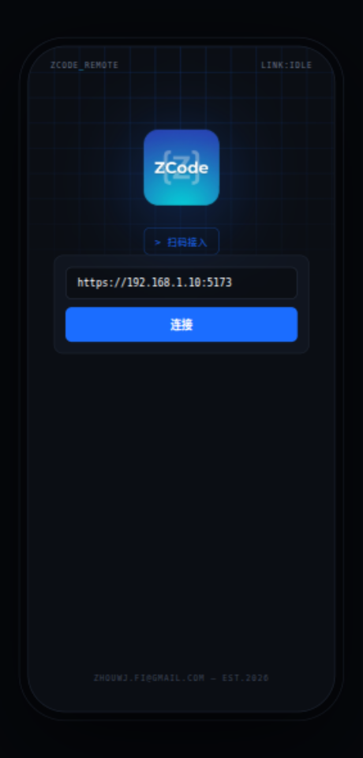
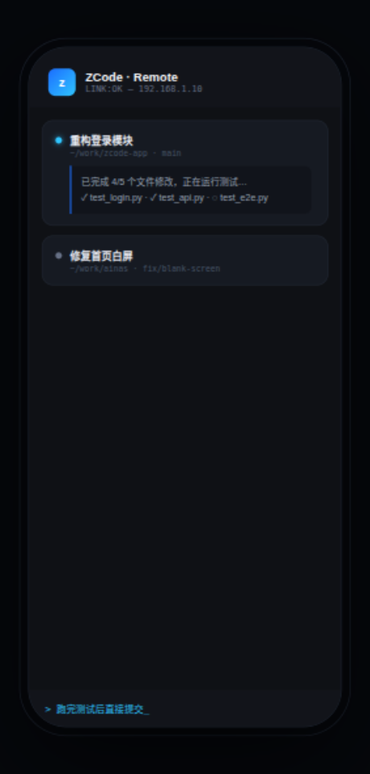

# ZCode

[English](README.md) | [简体中文](README.zh-CN.md)

Unofficial Android client for [ZCode](https://zcode.z.ai) Remote Control. Scan the QR code shown in the ZCode desktop app to connect to your desktop window from your phone — browse workspaces and tasks, follow Agent progress, and send follow-up instructions on the go. The connection URL is simply a website, so any web page still works too.

> Remote Control opens your running ZCode desktop window to the phone. Commands are executed by the machine behind the desktop workspace — the phone is just a control surface. See the [official docs](https://zcode.z.ai/en/docs/remote-control) for details.

## Features

- 📷 **Scan to connect** — scan the QR code from ZCode desktop's Remote Control dialog to set the connection URL (manual input also supported)
- 🖥 **Immersive fullscreen** — status bar and navigation bar hidden, no browser UI
- 🔒 **Persistent settings** — once configured, the app opens straight into the site
- ✋ **Long-press the app icon** → “Change URL” launcher shortcut to reopen setup
- 🔙 Back key exits via a dialog that also offers changing the URL
- Full Cookie / localStorage / JS support; external schemes (`tel:`, `mailto:`…) handed to the system
- Cleartext HTTP allowed, so intranet URLs work (disable via `usesCleartextTraffic` in the Manifest if desired)

## Usage

### 1. Connect by scanning (recommended)

Open ZCode on your desktop, start **Remote Control** to show the QR code, then open ZCode on your phone — scanning starts automatically, and the connection is made the moment the code is recognized.



### 2. Connect manually

Tap `> enter address manually`, type the address shown in the desktop Remote Control dialog (e.g. `https://192.168.1.10:5173`), then tap **Connect**.



### 3. Work from your phone

Once connected you can browse workspaces and tasks, follow Agent progress, and send follow-up instructions — commands run on the machine behind your desktop ZCode.



### Changing the URL

Long-press the **app icon** on the launcher → “Change URL”, or press Back at the end of web history and pick “Change URL”.

## Build

```bash
gradle wrapper && ./gradlew assembleDebug
```

Or simply open this directory in Android Studio.

APK output: `app/build/outputs/apk/debug/app-debug.apk`

## Install

```bash
adb install -r app/build/outputs/apk/debug/app-debug.apk
```
