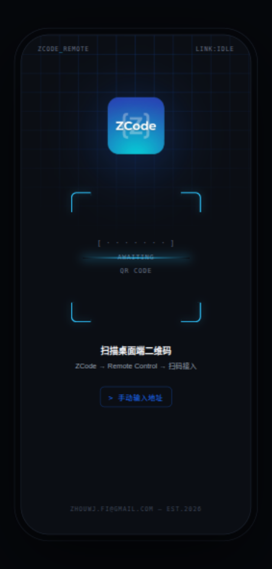
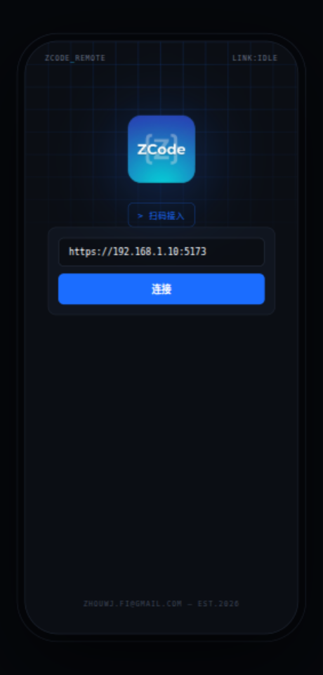
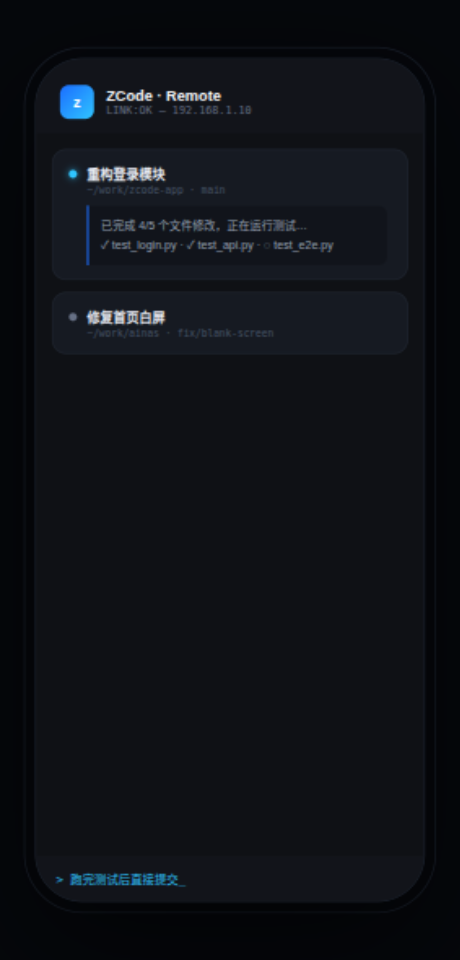

# ZCode

[English](README.md) | [简体中文](README.zh-CN.md)

[ZCode](https://zcode.z.ai) Remote Control 的安卓客户端。扫描 ZCode 桌面端弹出的二维码，即可在手机上连接到你的桌面窗口——查看和切换工作区与任务、跟进 Agent 进度、随时下达后续指令。连接本质上是一个网址，所以任意网页也可以正常打开。

> Remote Control 用于把当前 ZCode 桌面窗口临时开放给手机访问；指令由桌面端背后的机器执行，手机只是控制端。详见[官方文档](https://zcode.z.ai/cn/docs/remote-control)。

## 功能

- 📷 **扫码接入**：扫 ZCode 桌面端 Remote Control 弹窗中的二维码完成配置（也支持手动输入）
- 🖥 **全屏沉浸**：隐藏状态栏 / 导航栏，无任何浏览器 UI
- 🔒 **设置持久化**：URL 保存后，之后启动直接进入网页
- ✋ **长按应用图标** → 快捷方式「修改网址」重新打开设置页
- 🔙 返回键退出时弹窗，也可顺带修改网址
- Cookie / localStorage / JS 全支持；`tel:`、`mailto:` 等外部链接交给系统
- 允许 HTTP 明文，内网地址可用（可在 Manifest 关闭 `usesCleartextTraffic`）

## 使用

### 1. 扫码接入（推荐）

桌面端打开 ZCode → 启动 **Remote Control** 显示二维码 → 手机打开 ZCode app，自动开始扫码，识别即连。



### 2. 手动输入

点 `> 手动输入地址`，输入桌面端 Remote Control 弹窗中显示的地址（如 `https://192.168.1.10:5173`），点「连接」。



### 3. 手机上继续工作

连接后可查看/切换工作区与任务、跟进 Agent 进度、下达后续指令——指令由桌面端背后的机器执行。



### 修改网址

**长按桌面应用图标** →「修改网址」；或在网页退无可退时按返回键，选「修改网址」。

## 构建

```bash
gradle wrapper && ./gradlew assembleDebug
```

或用 Android Studio 直接打开本目录。

APK 输出：`app/build/outputs/apk/debug/app-debug.apk`

## 安装

```bash
adb install -r app/build/outputs/apk/debug/app-debug.apk
```
